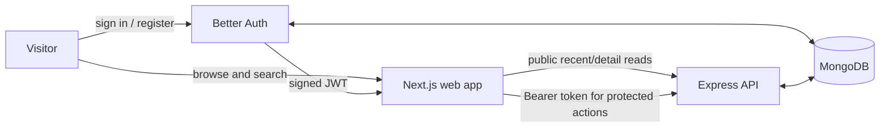

# Togetherly

> **Small acts. Stronger communities.** Togetherly helps neighbors discover local volunteer events, meet people who care, and organize something good together.

[](https://togetherlyhub.vercel.app/)
[](https://github.com/nnasif78/togetherly-client)
[](https://github.com/nnasif78/togetherly-server)

## Explore

- [Try Togetherly](https://togetherlyhub.vercel.app/)
- [Browse upcoming events](https://togetherlyhub.vercel.app/events)
- [Create an account](https://togetherlyhub.vercel.app/register)
- [Open the API project](https://github.com/nnasif78/togetherly-server)
- [Open the backend health check](https://togetherly-server-theta.vercel.app/)

<details>
<summary><strong>Contents</strong></summary>

- [What you can do](#what-you-can-do)
- [How it works](#how-it-works)
- [Pages and routes](#pages-and-routes)
- [Technology](#technology)
- [Run locally](#run-locally)
- [Environment variables](#environment-variables)
- [Project structure](#project-structure)
- [Related project](#related-project)
- [Contributing](#contributing)
- [License](#license)

</details>

## What you can do

- Discover upcoming community gatherings and search by event, location, description, or cause.
- Filter events by environment, education, health, community, charity, and other causes.
- Open an event by its readable title and date, view details, and join while places remain.
- Create an account with email and password or Google, then manage your profile.
- Create events, update or delete events you own, and review events you have joined.
- Switch the site theme and share event links.

The landing page, full event catalogue, and individual event details are public. An account is needed to join events and to create or manage events.

## How it works



The frontend is a Next.js App Router application. It uses Better Auth for email/password and Google sign-in. For protected API calls, the browser obtains a Better Auth JWT and sends it as a bearer token. The API verifies it against Better Auth's JWKS endpoint before using the authenticated user's ID. Event browsing and individual event details are public; joining and account actions require authentication.

## Pages and routes

| Route | What it does | Access |
| --- | --- | --- |
| `/` | Landing page and a short list of recent events | Public |
| `/events` | Upcoming event catalogue with search and cause filters | Public |
| `/events?category=Environment` | Catalogue filtered by category; search is client-side | Public |
| `/events/[id]` | Public event details; sign in to join | Public |
| `/login` | Email/password or Google sign-in | Public |
| `/register` | Account creation | Public |
| `/create-event` | Publish an event with a future date and capacity | Signed in |
| `/manage-events` | View events created by the current account | Signed in |
| `/edit-event/[id]` | Edit or delete an event you own | Signed in |
| `/joined-events` | Review events you joined | Signed in |
| `/profile-settings` | Update account profile details | Signed in |

Unknown routes are handled by Next.js. Protected pages redirect unauthenticated visitors to `/login`; the API enforces authentication on event mutations and account-specific endpoints.

## Technology

- **Client runtime:** Next.js `16.4.3` App Router, React `19.3.0`, TypeScript, Node.js, npm
- **UI and styling:** Tailwind CSS 4, Base UI, shadcn component tooling, `class-variance-authority`, `cn`, `next-themes`, Lucide icons, Sonner notifications
- **Forms and validation:** React Hook Form, `@hookform/resolvers`, Zod
- **Authentication:** Better Auth (`better-auth` and MongoDB adapter), email/password and Google OAuth, JWT plugin
- **Client data access:** MongoDB driver for auth storage; bearer-token requests to the API
- **Server runtime:** Express 5, Node.js `24.x`, Vercel Node.js functions
- **Server security and configuration:** `jose` for JWT/JWKS verification, `cors`, `dotenv`
- **Database:** MongoDB via the `mongodb` Node.js driver
- **Build and code quality:** TypeScript, ESLint with `eslint-config-next`, Tailwind CSS/Turbopack, React Compiler Babel plugin
- **Deployments:** Vercel for the Next.js client and Express API

## Run locally

### Requirements

- Node.js 24.x (used by the API; a compatible current Node.js release is recommended for the frontend)
- npm
- MongoDB access
- Google OAuth credentials for Google sign-in (optional if testing email/password only)
- Both Togetherly repositories cloned locally

```bash
git clone https://github.com/nnasif78/togetherly-client.git
git clone https://github.com/nnasif78/togetherly-server.git
```

Configure the server first using its [environment setup](https://github.com/nnasif78/togetherly-server#environment-variables), then start it in one terminal:

```bash
cd togetherly-server
npm install
npm run dev
```

The API defaults to `http://localhost:5000`. In a second terminal, from the client repository:

```bash
cd togetherly-client
npm install
npm run dev
```

Open [http://localhost:3000](http://localhost:3000). Use `npm run build` to create a production build, `npm start` to serve it, and `npm run lint` to run ESLint.

## Environment variables

Create `.env.local` at the client repository root. Never commit secrets.

| Variable | Required | Description |
| --- | --- | --- |
| `NEXT_PUBLIC_API_URL` | Yes | Base URL of the Togetherly API, without a trailing slash. For local development use `http://localhost:5000`; production uses `https://togetherly-server-theta.vercel.app`. |
| `MONGODB_URI` | Yes | MongoDB connection string used by Better Auth. |
| `DATABASE_NAME` | Yes | MongoDB database used by Better Auth. Keep this aligned with the backend's database. |
| `GOOGLE_CLIENT_ID` | For Google sign-in | OAuth client ID configured in Google Cloud Console. |
| `GOOGLE_CLIENT_SECRET` | For Google sign-in | OAuth client secret. Keep it private. |

For local Google OAuth, add `http://localhost:3000` as an authorized origin and the Better Auth callback URL shown by your local auth setup to the OAuth client. For production, configure the matching production origin and callback in Google Cloud Console. Confirm that `CLIENT_URL` on the API exactly matches the frontend origin that issues the JWT; see the [server README](https://github.com/nnasif78/togetherly-server#environment-variables).

<details>
<summary><strong>Example .env.local</strong></summary>

```dotenv
NEXT_PUBLIC_API_URL=http://localhost:5000
MONGODB_URI=mongodb+srv://<user>:<password>@<cluster>/<database>
DATABASE_NAME=togetherly
GOOGLE_CLIENT_ID=your-google-client-id
GOOGLE_CLIENT_SECRET=your-google-client-secret
```

Replace every placeholder with your own values. Do not paste production secrets into issues or commit this file.

</details>

## Project structure

```text
src/
├── app/                 # App Router pages, layouts, loading states, auth route
│   ├── api/auth/        # Better Auth request handler
│   ├── events/          # Event catalogue and details
│   ├── create-event/    # Event creation
│   ├── manage-events/   # Organizer's events
│   ├── joined-events/   # Attendee's events
│   └── ...              # Login, registration, profile, editing
├── components/          # Shared navigation, event cards, forms, UI
├── lib/                 # Auth setup, API token helper, category and slug utilities
└── proxy.ts             # Redirects unauthenticated visitors from protected pages
```

## Related project

The API repository documents its routes, JWT verification, MongoDB setup, and Vercel deployment: [togetherly-server](https://github.com/nnasif78/togetherly-server).

## Contributing

Issues and pull requests are welcome. When proposing a change, include a short description of the user-visible behavior and steps to reproduce or review it. Keep credentials and database data out of commits.

## License

No license file is currently included. Contact the repository owner before reusing this project beyond the permissions provided by GitHub's default terms.
